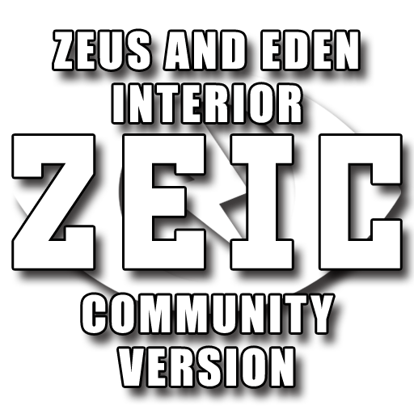

    
     
    
    

# ZEIC - Zeus and Eden Interiors, Community Version

Furnish and garrison buildings in seconds, in Zeus or in Eden. Place a module on a building, or on a whole town, and ZEIC fills the rooms with furniture and the windows with soldiers.

ZEIC is the community-maintained successor of ZEI and ZEI Continued. It is standalone: you don't need the original ZEI.

**Contributions are very welcome**, above all interior templates for buildings that don't have one yet.

## Pick your guide

| You want to... | Read |
|---|---|
| furnish and garrison buildings live, as Zeus | [Zeus guide](docs/zeus.md) |
| furnish buildings in Eden, for a mission you build | [Mission maker guide](docs/mission-makers.md) |
| use your own interior layouts in your missions | [Your own templates](docs/custom-templates.md) |
| make ZEIC furnish the buildings of your terrain or mod | [Mod author guide](docs/mod-authors.md) |
| report a bug, send a template or work on ZEIC itself | [Contributing](CONTRIBUTING.md) |
| look up what a module or field does | [Module reference](docs/modules.md) |

## What you need

- **Only the Zeus or mission maker needs ZEIC.** Other players don't, so it can be an optional mod.
- **In multiplayer the server needs it too** for Interior Fill, Advanced Fill and the Move AI trigger, because those objects and triggers are created on the server. On a server without ZEIC, these modules refuse to run and tell you why. Garrison Building, Fill Table / Shelf and Object Switch work without it. In singleplayer and on a game you host yourself, your game is the server.
- **No dependency in the mission file.** A mission furnished in Eden runs without ZEIC.
- Buildings of CUP Terrains, Global Mobilization, S.O.G. Prairie Fire, Western Sahara and OPTRE get their own templates, which load only when that mod is loaded.

## Modules

All modules are in the module list under **ZEIC - Interiors**. Every field and shortcut is explained in the [module reference](docs/modules.md).

### Interior Fill
- Furnishes a building, or a share of the buildings within a radius, from the templates of a category (Military, Civilian, CBRN, and any category a mod or mission adds).
- Simple objects (fastest), normal objects, or objects editable in Zeus.
- Shortcuts, held while placing: Alt repeats the last fill, Ctrl fills Military, Shift Civilian, Ctrl+Shift CBRN.

### Garrison Building
- Fills a building, or a share of the buildings within a radius, with infantry of any faction (supports any units addon).
- Units as a percentage of each building's positions, with a live estimate of the unit count; asks before creating over 400 units.
- Pick a faction and subcategory from one list (e.g. NATO Men (Special Forces)), with side filter and search; recently used ones are listed on top.
- Optional Move AI trigger: the units hold their positions until an enemy player comes close, then some and later all of them move.
- Attempts to find the best direction for the units to face. Avoids spawning pilots, crew etc.
- Hold Alt while placing to garrison again with the last settings.

### Advanced Fill
- Furnishes and garrisons a building, or a share of the buildings within a radius, in one go: per building the interior first, then the units. Either part can be turned off.
- Collision check: units aren't placed on positions blocked by furniture. Choose whether the units or the furniture give way.
- Fill modifiers change what a template places: Military defences only, No modern electronics, Cold War era.
- Hold Alt while placing to fill again with the last settings.

### Fill Table / Shelf
- Puts small objects on a table, shelf or rack (food, medical, office, tools, modern or old electronics, CBRN cleaning or random).
- Choose how full and how the objects are created.
- Hold Alt while placing to fill again with the last settings.

### Object Switch
- Swaps military objects within a radius for another camouflage set (e.g. green sandbags for brown ones), including CUP and S.O.G. sets when those mods are loaded.

### Template tools (Eden only)
Under **ZEIC - Interiors Development**, for making your own templates:
- **Save Building Scheme** copies the objects in and around a building as a template, ready to paste into a mission or a mod.
- **Mark Positions** shows the building positions of a building, so you don't block them with furniture.
- **List Buildings** (VR only) lines up the buildings that have few or no templates yet.

## What's new compared to ZEI
- New dialogs in the style of Zeus Enhanced, with a description of each module; translatable.
- Buildings are processed over several frames (no freezes on large areas), with coloured wireframes showing the progress to every Zeus.
- Templates live in config: any mod or mission can add templates and categories. Template addons load only with their mod.
- Area fills and area garrisons with a radius preview on the ground.
- New Advanced Fill module: furnish and garrison in one go, with a collision check and fill modifiers.
- Eden: one layer per module, fill and building.

## About

### Why a community version when there is ZEI Continued
I tried to contact the author of ZEI Continued via Steam Workshop, GitHub and Discord to offer my help to maintain and streamline "ZEI Continued", but never got a response, and the last update was on 10 Mar 2025.

I am looking for co-maintainers, so the mod doesn't go stale when I don't have time for it.

### Technical details
- Built and signed with HEMTT. Each update produces a new bikey.

### Links
- [GitHub: ZEIC - Zeus and Eden Interiors, Community Version](https://github.com/CVO-Org/ZEIC)
- [Steam Workshop: ZEI - Zeus and Eden Interior - The Original](https://steamcommunity.com/sharedfiles/filedetails/?id=1251859358)
- [Steam Workshop: ZEI - Zeus and Eden Interiors ( Continued )](https://steamcommunity.com/sharedfiles/filedetails/?id=3438718557)
- [Bohemia Forums: ZEI - Zeus and Eden Interior](https://steamcommunity.com/sharedfiles/filedetails/?id=1920324184)

### Credits
[List of Authors](https://github.com/CVO-Org/ZEIC/blob/main/AUTHORS.txt)
